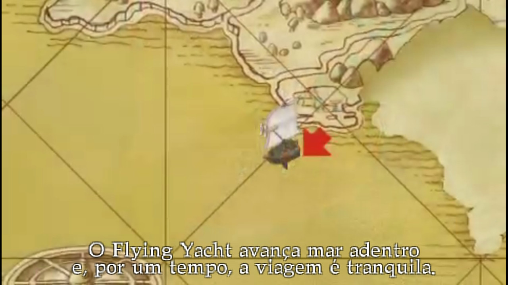
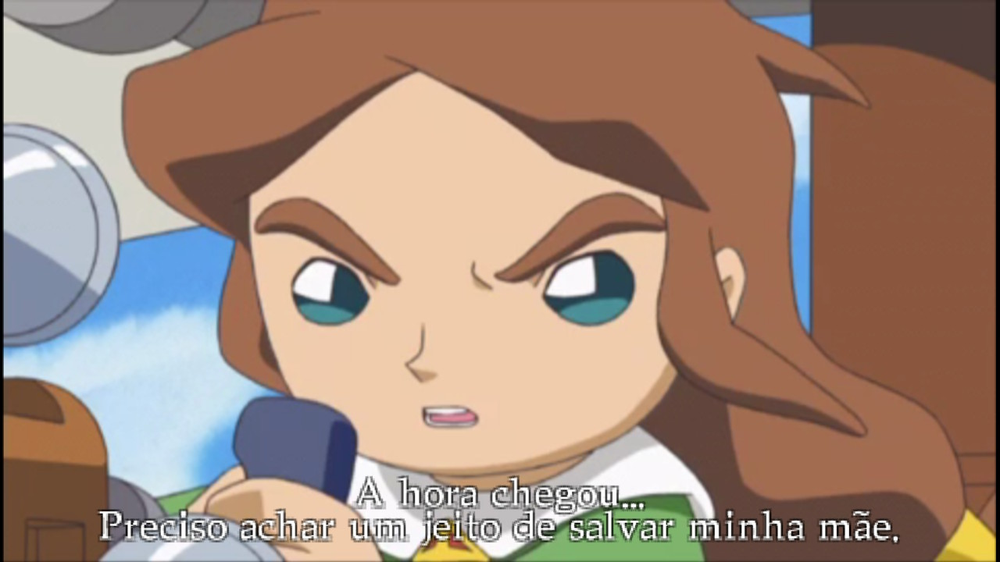

# PoPoLoCrois (PSP) — Tradução PT-BR

Tradução para português do Brasil de **PoPoLoCrois** (versão americana, ULUS10018, PSP). Versão **0.46 (beta)**.

## O que está traduzido
- Menus, descrições de itens, golpes e mensagens de batalha.
- Diálogos da história (Episódio I, Livros I a V) e a maior parte das cenas.
- Falas de mapas e cidades, incluindo Bryonia, o castelo do Devil e o Livro IV (mapas 30 a 34).
- Legendas dos vídeos de animação da história (29 vídeos).
- Mensagens de sistema, como "item obtido".

Ainda em inglês: alguns mapas (ca, td, cb, 40 a 43), créditos e mapa-múndi. Nomes de itens, armas e técnicas ficam em inglês de propósito. O texto ainda não passou por revisão editorial.

Problema conhecido: numa sala de máquinas, blocos de cenário aparecem bagunçados. Ainda não se sabe se acontece no jogo original.

## Como aplicar
O jogo **não** é distribuído. Você precisa da sua própria ISO original:

- Tamanho: 1.259.372.544 bytes
- SHA-256: `10a8bd3275d716736a70b63ee308070c52f3b79403d146765dc2e6d50ce89222`

Aplique o patch com [xdelta3](https://github.com/jmacd/xdelta) (ou xdeltaUI):

```
xdelta3 -d -s "PoPoLoCrois (USA).iso" PoPoLoCrois_PTBR_traducao46.xdelta PoPoLoCrois_PT-BR_v0.46.iso
```

SHA-256 esperado da ISO resultante: `37a8931dc2ced4128d8ad81c3a5079ed36aa844ad42c84b60ed62f23c8ee3912`

Patch: 583.422 bytes, SHA-256 `7300c52fb7fc95dd70c0562cfdfc15c49fa2feaee83906290d775bdccdc09b69`.

Testado no PPSSPP (PC e Nintendo Switch).

## Capturas




## Créditos
Tradução e hack: Anondaniel.
